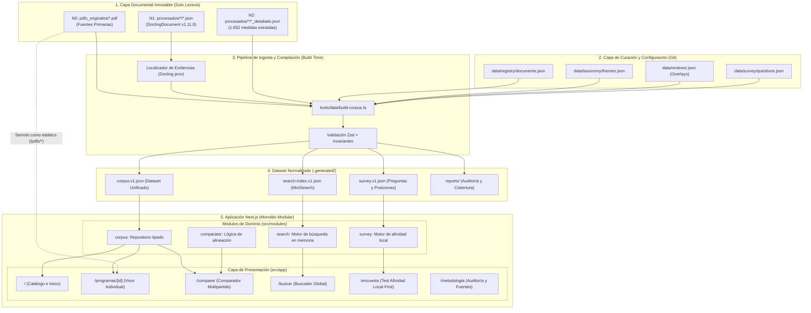

# ARCHITECTURE — Arquitectura Técnica del Proyecto 29N

- **Versión:** 1.0.0
- **Fecha:** 2026-11-12
- **Estado:** Decisión técnica final aprobada
- **Decisiones clave asociadas:** [D-001 a D-018](DECISIONS.md)

---

## 1. Visión General y Estilo Arquitectónico

La arquitectura del proyecto 29N adopta el patrón de **Monolito Modular Desacoplado** implementado con **Next.js (App Router)**, **React 19** y **TypeScript estricto**, con un pipeline de ingesta determinista en tiempo de compilación (*build-time data compilation*).

Esta arquitectura responde a los siguientes imperativos de ingeniería:
1. **Desacoplamiento documental:** El corpus existente (`pdfs_originales/`, `procesados/`) permanece 100% inmutable y separado del código de la aplicación.
2. **Infraestructura cero (Zero-Server State):** Para el alcance MVP, se prescinde de bases de datos relacionales en servidor (PostgreSQL, Supabase, Redis), servidores de colas o servicios externos de inferencia. La aplicación compila todos sus datos en artefactos JSON estáticos inmutables y tipados bajo `.generated/`.
3. **Alto rendimiento y disponibilidad global:** Renderizado estático preferente (*Static Site Generation - SSG* e *Incremental Static Regeneration - ISR*), permitiendo alojamiento en cualquier red CDN (Vercel, Netlify, Cloudflare Pages o contenedor Docker estándar) con costes de operación prácticamente nulos y resistencia absoluta a picos de tráfico electoral.
4. **Privacidad garantizada (Local-First):** La lógica sensible de afinidad ideológica se ejecuta íntegramente en el navegador web del usuario.

---

## 2. Diagrama de Arquitectura de Capas



---

## 3. Estructura de Directorios del Repositorio

```text
29N/
├── pdfs_originales/               # N0: Documentos PDF originales inmutables (Solo Lectura)
├── procesados/                    # N1 y N2: Artefactos Docling y análisis detallados (Solo Lectura)
├── logs/                          # Registros históricos de conversiones
├── scripts/                       # Scripts de auditoría y automatización
│   └── auditar_corpus.py          # Script de auditoría reproducible
├── docs/                          # Documentación canónica de ingeniería
│   ├── audit/                     # Salidas de auditoría técnica (audit_result.json)
│   ├── AGENTS.md                  # Instrucciones de programación para agentes
│   ├── ARCHITECTURE.md            # Arquitectura del sistema (este documento)
│   ├── DATA_AUDIT.md              # Resultados de auditoría forense
│   ├── DATA_MODEL.md              # Contratos de datos, tipos y esquemas
│   ├── DECISIONS.md               # Architecture Decision Records (ADRs)
│   ├── IMPLEMENTATION_PLAN.md     # Plan secuencial de ejecución
│   ├── PRODUCT_BRIEF.md           # Definición estratégica del producto
│   ├── PRD.md                     # Requisitos funcionales y auditoría de promt.md
│   └── STATUS.md                  # Estado del proyecto y siguiente tarea
│
├── data/                          # N3: Capa de curación y configuración humana (Versionada en Git)
│   ├── registry/documents.json    # Registro formal de partidos y programas
│   ├── taxonomy/themes.json       # Definición de los 19 bloques canónicos
│   ├── reviews/                   # Overlays de corrección editorial por partido
│   │   ├── pp.json
│   │   ├── frente-obrero.json
│   │   ├── partido-humanista.json
│   │   └── salf.json
│   └── survey/questions.json      # Banco de 15 preguntas y posiciones de partidos
│
├── .generated/                    # N4: Dataset compilado en build time (IGNORADO en Git)
│   ├── corpus.v1.json
│   ├── search-index.v1.json
│   ├── survey.v1.json
│   └── reports/
│
├── tools/                         # Herramientas de soporte y compilación de datos
│   └── data/
│       ├── build-corpus.ts        # Pipeline principal de compilación N0-N3 -> N4
│       ├── locate-evidence.ts     # Localizador de citas y páginas sobre Docling
│       └── export-schema.ts       # Generador de .schema.json a partir de Zod
│
├── src/                           # Código fuente de la aplicación Next.js
│   ├── app/                       # App Router: Rutas, layouts y páginas
│   │   ├── layout.tsx             # Layout raíz accesible (SkipLink, Navbar, Footer)
│   │   ├── page.tsx               # Catálogo de programas e Inicio
│   │   ├── programas/
│   │   │   └── [partyId]/page.tsx # Visor individual del programa
│   │   ├── comparar/page.tsx      # Comparador multipartido
│   │   ├── buscar/page.tsx        # Buscador global con filtros
│   │   ├── encuesta/page.tsx      # Test de afinidad local-first
│   │   └── metodologia/page.tsx   # Transparencia metodológica y auditoría
│   │
│   ├── modules/                   # Módulos de dominio modular desacoplados
│   │   ├── corpus/                # Repositorio tipado, esquemas Zod y loaders
│   │   │   ├── types.ts
│   │   │   ├── schema.ts
│   │   │   └── repository.ts
│   │   ├── search/                # Lógica del motor de búsqueda (MiniSearch)
│   │   ├── comparator/            # Lógica de alineación por bloques temáticos
│   │   ├── survey/                # Algoritmo de cálculo de afinidad y métricas
│   │   └── ui/                    # Sistema de diseño, tokens y componentes accesibles
│   │       ├── components/        # Botones, tarjetas, modales, alertas, tablas
│   │       ├── tokens.css         # Tokens de diseño y variables CSS
│   │       └── icons/             # Iconos SVG accesibles
│   │
│   └── public/                    # Archivos estáticos públicos
│       └── pdfs/ -> symlink o regla de servicio a pdfs_originales/
│
├── .gitignore
├── package.json
├── tsconfig.json
├── tailwind.config.ts
└── next.config.ts
```

---

## 4. Contratos de Módulos de Dominio

### 4.1 Módulo `corpus` (`src/modules/corpus`)
- **Responsabilidad:** Carga, deserialización, tipado estricto y consulta en memoria del dataset unificado (`corpus.v1.json`).
- **Contrato:**
  ```ts
  interface CorpusRepository {
    getParties(): Promise<Party[]>;
    getPartyById(id: string): Promise<Party | null>;
    getProgramByPartyId(partyId: string): Promise<Program | null>;
    getThemes(): Promise<Theme[]>;
    getProposalsByPartyAndTheme(partyId: string, themeId: string): Promise<Proposal[]>;
    getPublishedProposals(): Promise<Proposal[]>;
    getCoverageReport(): Promise<CoverageReport>;
  }
  ```

### 4.2 Módulo `search` (`src/modules/search`)
- **Responsabilidad:** Ejecución de búsquedas instantáneas de texto completo con tolerancia a erratas (fuzzy search) y filtros facetados.
- **Contrato:**
  ```ts
  interface SearchQuery {
    text: string;
    partyIds?: string[];
    themeIds?: string[];
    onlyVerified?: boolean;
    limit?: number;
    offset?: number;
  }
  interface SearchResult {
    items: SearchHit[];
    total: number;
    facetCounts: {
      parties: Record<string, number>;
      themes: Record<string, number>;
    };
  }
  ```

### 4.3 Módulo `comparator` (`src/modules/comparator`)
- **Responsabilidad:** Construcción de la matriz comparativa de 2 a 4 formaciones frente a los 19 bloques canónicos.
- **Contrato:**
  ```ts
  interface ComparisonMatrix {
    parties: Party[];
    blocks: Array<{
      theme: Theme;
      columns: Record<string, {
        hasProposals: boolean;
        proposals: Proposal[];
        statusNote?: string; // ej. "Sin propuestas registradas en este bloque"
      }>;
    }>;
  }
  ```

### 4.4 Módulo `survey` (`src/modules/survey`)
- **Responsabilidad:** Motor de cálculo de afinidad matemática local-first.
- **Contrato:**
  ```ts
  interface UserAnswers {
    [questionId: string]: -2 | -1 | 0 | 1 | 2 | null; // null = "Prefiero no responder"
  }
  interface AffinityResult {
    partyId: string;
    affinityPercentage: number;
    coverage: {
      answeredCount: number;
      eligibleQuestionsCount: number;
      insufficientOrMissingCount: number;
    };
    breakdownByTheme: Record<string, number>;
    keyDifferences: Array<{
      questionId: string;
      userAnswer: number;
      partyPosition: number;
      evidenceProposalIds: string[];
    }>;
  }
  ```

---

## 5. Pipeline de Ingesta y Validación de Datos (`tools/data/`)

El pipeline se ejecuta antes de cualquier compilación (`prebuild`) o bajo demanda:
```bash
npm run data:build
```

### Fases de Ejecución:
1. **Comprobación de Integridad Criptográfica:** Recalcula el SHA-256 de los 9 archivos en `pdfs_originales/` y los coteja contra `metadata.json`. Si un hash difiere, el proceso se detiene inmediatamente con código de error.
2. **Extracción y Enlace de Evidencias (`locate-evidence.ts`):**
   - Carga el árbol `DoclingDocument` de cada partido desde `procesados/<Doc>/<Doc>.json`.
   - Indexa todas las cajas de texto y celdas de tablas con sus coordenadas y procedencia (`prov[0].page_no`).
   - Normaliza el `texto_oficial` de cada una de las 1.652 medidas y busca su correspondencia exacta o fragmentada.
   - Genera el objeto `Evidence` vinculando el número de página del PDF oficial.
3. **Aplicación de Overlays de Curación (`data/reviews/*.json`):**
   - Aplica correcciones manuales y ajustes de estado de revisión.
   - Pone en cuarentena automática (`requiere_revision`) cualquier medida que presente textos parafraseados o alertas en partidos en remediación (Partido Humanista, SALF).
   - Marca las 8 casillas de campaña del PP como `kind: "reservada"` y `status: "rechazada"`.
4. **Validación Zod Integral:**
   - Valida el 100% de las entidades generadas contra los esquemas de `DATA_MODEL.md`.
   - Comprueba las 9 invariantes de consistencia (unicidad de IDs, referencias cruzadas válidas, presencia de evidencia en propuestas publicables).
5. **Generación de Artefactos de Entrega:**
   - Escribe `.generated/corpus.v1.json`.
   - Genera e indexa el índice de búsqueda en `.generated/search-index.v1.json`.
   - Exporta las preguntas y posiciones revisadas en `.generated/survey.v1.json`.
   - Emite el informe de cobertura y auditoría en `.generated/reports/`.

---

## 6. Estrategia de Entrega de Archivos Originales (PDFs)

Los 9 archivos PDF originales son esenciales para la verificabilidad de la plataforma. Para servirlos eficientemente sin duplicarlos en disco:
- En desarrollo y despliegues estáticos, se configuran enlaces simbólicos o rutas de reescritura en `next.config.ts` para exponer la carpeta `pdfs_originales/` bajo la ruta pública `/pdfs/:path*`.
- Cada enlace de evidencia en la interfaz apunta a:
  `/pdfs/[nombre_archivo].pdf#page=[numero_pagina]`
  permitiendo que el visor PDF nativo del navegador del usuario salte directamente a la página certificada.

---

## 7. Sistema de Diseño, Tokens y Accesibilidad (WCAG 2.2 AA)

Se adopta un enfoque de **Design Tokens** semánticos gestionados en CSS y consumidos por Tailwind CSS:
- **Tipografía:** Fuente sans-serif de alta legibilidad (`Inter` o `Geist Sans`), con escalas de tamaño predecibles y espaciado interlineal generoso (mínimo 1.5 en cuerpo).
- **Colores y Contraste:**
  - Colores de fondo neutros y texto de alto contraste (ratio ≥ 7:1 en lectura principal, ≥ 4.5:1 en elementos secundarios).
  - Colores distintivos sobrios para partidos políticos, utilizados exclusivamente como detalles decorativos o etiquetas, nunca como único portador de información.
- **Navegación Accesible:**
  - Componente `<SkipToContent />` al inicio de cada página.
  - Indicadores de foco (`focus-visible`) nítidos de 2px de grosor.
  - Atributos semánticos `role`, `aria-expanded`, `aria-controls` en acordeones y selectores del comparador.
  - Pruebas automatizadas en CI mediante `@axe-core/playwright`.

---

## 8. Rendimiento, SEO y Observabilidad

- **SSG Preferente:** Las páginas de inicio, catálogos, visores de programas (`/programas/[partyId]`) y metodología se pre-renderizan completamente en tiempo de compilación.
- **Rendimiento de Búsqueda:** El índice MiniSearch serializado (~800 KB comprimido en gzip) se descarga de manera diferida únicamente cuando el usuario accede a `/buscar` o enfoca el campo de búsqueda rápida, garantizando un TTI (*Time to Interactive*) < 1.0 s en la home.
- **SEO Cívico:** Generación automática de `sitemap.xml` dinámico con todas las rutas canónicas de programas y bloques temáticos, etiquetas Open Graph y Twitter Cards neutrales sin sesgo político.
- **Monitoreo:** Registro estructurado en consola de incidencias de ingesta y tiempos de carga. Sin rastreadores de analítica intrusiva de terceros (cumplimiento RGPD).
