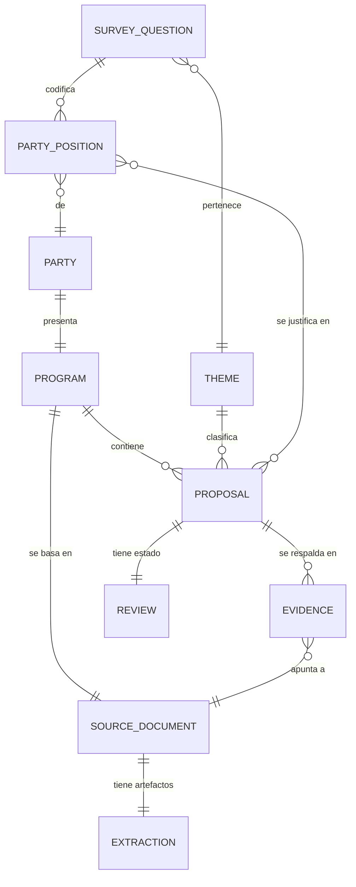
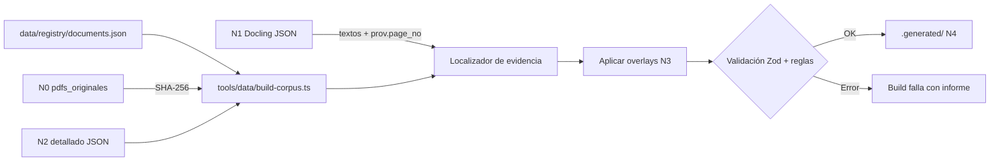

# DATA_MODEL — Entidades, relaciones y esquema versionado

> Estado: **diseño aprobado para implementación (Fase 2)**. Nada de esto está implementado todavía.
> Las decisiones que lo justifican están en [`DECISIONS.md`](DECISIONS.md) (D-003 a D-008, D-015 a D-018).

---

## 1. Jerarquía de datos (inequívoca)

| Nivel | Qué es | Dónde vive | Mutabilidad | Uso por la aplicación |
| :---: | :--- | :--- | :--- | :--- |
| **N0** | **Fuente primaria.** PDF oficial del partido. | `pdfs_originales/*.pdf` | **Inmutable.** Identificado por SHA-256. | Se enlaza y se sirve tal cual. |
| **N1** | **Artefactos de extracción** (Docling): Markdown, JSON (`DoclingDocument` 1.11.0), TXT, `metadata.json`. | `procesados/<Doc>/<Doc>.{md,json,txt}`, `metadata.json` | **Solo lectura.** No se regeneran ni se editan. | El JSON se usa para **localizar evidencia** (página + fragmento). MD y TXT no se consumen en el MVP. |
| **N2** | **Análisis derivados por IA** (`*_medidas_detallado.json/.md`). | `procesados/<Doc>/<Doc>_<N>medidas_detallado.*` | **Solo lectura.** | El JSON aporta la **lista candidata** de medidas, su sección original y el bloque propuesto. Nunca se considera verdad. El MD no se consume. |
| **N3** | **Datos curados** por personas: registro de documentos, taxonomía, revisiones, banco de la encuesta. | `data/` (nuevo, versionado en git) | Editable mediante PR revisado. | Correcciones y verificaciones que prevalecen sobre N2. |
| **N4** | **Datos normalizados** para la aplicación: composición validada de N0–N3. | `.generated/` (no versionado, reproducible) | Se regenera en cada build. | Única entrada de la interfaz. |

### Reglas de precedencia

1. Si N3 contiene una corrección para un campo, prevalece sobre N2.
2. Un texto solo puede presentarse como **cita literal** si su evidencia se ha localizado en N1 y,
   para publicarse como *verificado*, una persona lo ha confirmado contra N0 (estado `verificada` o `corregida`).
3. Ningún dato de N2 se publica como afirmación del partido sin pasar las reglas de §7.
4. N4 nunca se edita a mano; si algo está mal, se corrige en N3 o en el código de ingesta.
5. Ningún proceso escribe en `pdfs_originales/` ni en `procesados/`.

---

## 2. Diagrama de entidades



---

## 3. Tipos transversales

### 3.1 Valor con verificación (`Verifiable<T>`)

Cualquier metadato que no proceda de N0 o de un cálculo determinista se envuelve así:

```ts
type Verification = "no_verificado" | "verificado";
interface Verifiable<T> {
  value: T | null;
  verification: Verification;
  origin: "detallado_ia" | "metadata_extraccion" | "revision_manual" | "calculado";
  verified_by?: string;      // obligatorio si verification = "verificado"
  verified_at?: string;      // ISO 8601
  note?: string;
}
```

### 3.2 Estado de revisión de una medida (`ReviewStatus`)

Enumeración única (sustituye a las varias listas inconsistentes de `promt.md`):

| Estado | Significado | Quién lo asigna | ¿Publicable? |
| :--- | :--- | :--- | :--- |
| `extraida` | Registro de N2 sin revisión humana y sin alertas automáticas. | Ingesta | Sí, con aviso "pendiente de revisión" (ver §7) |
| `requiere_revision` | La ingesta detectó un problema (evidencia no localizada o parcial, anotaciones en el texto, partido marcado para remediación). | Ingesta | **No** |
| `verificada` | Una persona confirmó texto y evidencia contra el PDF sin cambios. | Revisor | Sí |
| `corregida` | Una persona corrigió texto, sección, página o bloque (la corrección está en N3). | Revisor | Sí |
| `rechazada` | No es una propuesta (p. ej., medida reservada) o no tiene respaldo en el documento. | Revisor o regla documentada | **No** |

Transiciones permitidas: `extraida|requiere_revision → verificada|corregida|rechazada`;
`verificada|corregida → requiere_revision` (si cambia la fuente). Cada transición queda registrada
con `reviewer`, `date` y `note` en el overlay de N3.

### 3.3 Calidad de localización de evidencia (`MatchQuality`)

`literal` · `fragmentado` · `parcial` · `no_localizado` (definiciones en `DATA_AUDIT.md` §2.4).

### 3.4 Estado de posición para encuesta (`PositionStatus`)

Distinción obligatoria entre ausencia de referencia, información insuficiente y posición:

| Estado | Significado | Valor numérico | Entra en el cálculo |
| :--- | :--- | :--- | :--- |
| `posicion` | Hay evidencia explícita en el programa que permite codificar dirección e intensidad. | −2 … +2 | Sí |
| `insuficiente` | El programa trata el tema, pero la evidencia no permite codificar una posición sobre la afirmación concreta. | `null` | No |
| `sin_referencia` | No se ha localizado ninguna referencia en el programa tras búsqueda documentada. **No implica posición.** | `null` | No |

---

## 4. Entidades

Convenciones: claves en `snake_case`, en inglés para la estructura y en español para los valores de
enumeraciones visibles. Todas las fechas en ISO 8601. Todos los archivos llevan `schema_version`.

### 4.1 `Party`

| Campo | Tipo | Notas |
| :--- | :--- | :--- |
| `id` | `string` (slug) | `bng`, `coalicion-canaria`, `frente-obrero`, `iustitia-europa`, `pnv`, `pp`, `partido-humanista`, `por-un-mundo-mas-justo`, `salf` |
| `name` | `Verifiable<string>` | Nombre completo (de N2 hasta verificarse) |
| `short_name` | `Verifiable<string>` | Siglas |
| `legacy_id_prefix` | `string` | `BNG`, `CCa`, `FO`, `IE`, `EAJ-PNV`, `PP`, `PH`, `M+J`, `SALF` |
| `website` | `Verifiable<string>` | URL (de N2, no verificada) |

No se incluyen ideología, escaños previos, líderes ni logotipos en el MVP (no constan en el corpus).

### 4.2 `SourceDocument` y `Extraction`

| Campo | Tipo | Notas |
| :--- | :--- | :--- |
| `id` | `string` | Igual al nombre estándar: `PP_programa29N` |
| `pdf_path` | `string` | Relativo a la raíz: `pdfs_originales/PP_programa29N.pdf` |
| `sha256` | `string` (hex minúsculas) | Recalculado en cada build y comparado con `metadata.json` |
| `bytes`, `page_count` | `number` | Calculados |
| `original_filename` | `string` | De `metadata.json.archivo_original` |
| `official_url` | `Verifiable<string>` | De N2 hasta verificarse |
| `retrieved_at` | `Verifiable<string>` | Desconocido hoy (`value: null`) |
| `license_note` | `string \| null` | Pendiente de revisión legal |
| `extraction.tool` | `string` | De `metadata.json.herramienta` |
| `extraction.processed_at` | `string` | De `metadata.json.fecha_procesamiento` |
| `extraction.artifacts` | `{ md, json, txt, metadata }` | Rutas relativas a N1 |
| `extraction.detailed` | `{ json, md }` | Rutas relativas a N2 |

### 4.3 `Program`

| Campo | Tipo | Notas |
| :--- | :--- | :--- |
| `id` | `string` | `pp-29n-2026` |
| `party_id` | `string` | |
| `election_id` | `string` | `generales-2026-11-29` |
| `title` | `Verifiable<string>` | De N2 |
| `publication_date` | `Verifiable<string>` | De N2 |
| `source_document_id` | `string` | |
| `languages` | `string[]` | Idioma(s) del texto oficial (`es`, `gl`, …) |
| `stats` | objeto calculado | `extracted`, `published`, `requires_review`, `rejected`, `verified`, por bloque |

### 4.4 `Theme` (taxonomía)

Se adopta la taxonomía canónica de 19 bloques ya presente, idéntica en los nueve detallados, más un
cajón explícito para medidas fuera de taxonomía.

| `id` | `legacy_id` | Título |
| :--- | :--- | :--- |
| `vivienda` | `bloque_01` | Vivienda, Urbanismo, Alquiler y Lucha contra la Okupación |
| `economia` | `bloque_02` | Economía, Productividad, Industria, Innovación y Turismo |
| `fiscalidad` | `bloque_03` | Fiscalidad e Impuestos |
| `empleo` | `bloque_04` | Empleo, Autónomos, Emprendimiento y Mercado Laboral |
| `pensiones-bienestar` | `bloque_05` | Pensiones, Mayores, Reto Demográfico, Discapacidad e Igualdad |
| `familia-infancia` | `bloque_06` | Familia, Natalidad, Conciliación, Infancia y Juventud |
| `sanidad` | `bloque_07` | Sanidad Pública, Salud Mental y Dependencia |
| `educacion` | `bloque_08` | Educación, Formación Profesional y Universidad |
| `energia` | `bloque_09` | Energía, Transición Ecológica y Soberanía Energética |
| `rural` | `bloque_10` | Agricultura, Ganadería, Pesca, Agua y Mundo Rural |
| `infraestructuras` | `bloque_11` | Infraestructuras, Transporte, Ferrocarril y Conectividad |
| `administracion` | `bloque_12` | Administración Pública, Control del Gasto Público y Reducción de Burocracia |
| `justicia-seguridad` | `bloque_13` | Justicia, Seguridad Ciudadana y Cumplimiento de la Ley |
| `inmigracion` | `bloque_14` | Inmigración, Control de Fronteras, Integración y Nacionalidad |
| `regeneracion` | `bloque_15` | Regeneración Democrática, Independencia Institucional y Lucha contra la Corrupción |
| `territorial` | `bloque_16` | Cohesión Territorial, Financiación Autonómica, Presencia del Estado y Ceuta y Melilla |
| `cultura` | `bloque_17` | Cultura, Deporte, Historia Común y Víctimas del Terrorismo |
| `emergencias` | `bloque_18` | Gestión de Emergencias y Protección Civil |
| `defensa-exterior` | `bloque_19` | Defensa Nacional, Fuerzas Armadas y Política Exterior |
| `otros` | `otro_bloque_*` | Otras materias (p. ej., "Protección y Bienestar Animal" de M+J) |

> [!NOTE]
> Los títulos heredan connotaciones de la fase de análisis (p. ej., "Lucha contra la Okupación",
> "Víctimas del Terrorismo"). La revisión de neutralidad de los **títulos visibles** es la tarea E-4
> del plan; los `id` son estables y no dependen del título.

Subtemas: fuera del MVP (no existen en los datos).

### 4.5 `Proposal` (medida)

| Campo | Tipo | Origen | Notas |
| :--- | :--- | :--- | :--- |
| `id` | `string` | calculado | `{party_id}-{nnn}` con `nnn` = `numero_medida` a 3 dígitos. Ej.: `por-un-mundo-mas-justo-001` |
| `legacy_id` | `string` | N2 | `id_medida` original (`M+J-001`) |
| `program_id` | `string` | | |
| `extraction_number` | `number` | N2 | `numero_medida`. **No** es necesariamente la numeración oficial |
| `official_number` | `Verifiable<string>` | N3 | Numeración del PDF cuando se verifique |
| `kind` | `"propuesta" \| "reservada"` | N2/N3 | `reservada` para las 8 del PP |
| `title` | `{ text, origin }` | N2 | `origin: "detallado_ia"` hasta revisión |
| `official_text` | `{ text, origin, language }` | N2 → N3 | `origin`: `detallado_ia` (candidato) · `docling` (sustituido por fragmento de N1) · `revision_manual` |
| `original_section` | `Verifiable<string>` | N2 | `seccion_original` |
| `theme_id` | `string` | N2 → N3 | |
| `theme_assignment` | `{ method: "ia" \| "manual", reviewed: boolean }` | | La clasificación temática es derivada |
| `evidence` | `Evidence[]` | calculado/N3 | Al menos 1 si es publicable |
| `review` | `Review` | calculado/N3 | |
| `ai_annotations` | `{ summary, arguments_for, arguments_against }` | N2 | `explicacion_medida`, `datos_a_favor`, `datos_en_contra`. **No publicados** en el MVP (D-006) |
| `flags` | `string[]` | calculado | `anotacion_en_texto`, `texto_no_literal`, `numeracion_no_oficial`, `idioma_no_castellano`, … |

### 4.6 `Evidence`

| Campo | Tipo | Notas |
| :--- | :--- | :--- |
| `source_document_id` | `string` | |
| `pages` | `number[]` | Desde `prov.page_no` de Docling (1-indexado, coincide con el PDF) |
| `snippet` | `string` | Fragmento de N1 (≤ 600 caracteres) |
| `docling_refs` | `string[]` | Punteros JSON (`#/texts/123`) para auditoría |
| `match` | `MatchQuality` | |
| `method` | `"auto_docling" \| "manual"` | |
| `verified` | `boolean` | `true` solo con revisión humana |
| `pdf_href` | `string` | Calculado: `/pdfs/PP_programa29N.pdf#page=34` |

### 4.7 `Review`

```ts
interface Review {
  status: ReviewStatus;
  history: { status: ReviewStatus; reviewer: string; date: string; note?: string }[];
}
```

### 4.8 `SurveyQuestion` y `PartyPosition`

| Campo | Tipo | Notas |
| :--- | :--- | :--- |
| `id` | `string` | `q-vivienda-01` |
| `statement` | `string` | Afirmación neutral, una sola idea, sin mencionar partidos |
| `theme_id` | `string` | |
| `modes` | `("5min" \| "10min" \| "15min")[]` | MVP: solo `5min` |
| `positions` | `Record<party_id, PartyPosition>` | **Los nueve partidos obligatoriamente** (aunque sea `sin_referencia`) |
| `review` | `Review` | La pregunta entera debe estar `verificada` para publicarse |

```ts
interface PartyPosition {
  status: PositionStatus;              // posicion | insuficiente | sin_referencia
  value: -2 | -1 | 0 | 1 | 2 | null;   // null salvo status = "posicion"
  evidence_proposal_ids: string[];     // obligatorio (≥1) si status = "posicion" o "insuficiente"
  rationale: string;                   // justificación editorial breve
  origin: "ia_borrador" | "manual";
  review: Review;                      // debe estar verificada para usarse
}
```

---

## 5. Archivos y esquemas

### 5.1 Datos curados (N3) — `data/`

```text
data/
├── registry/documents.json      # Party + SourceDocument + Program: rutas a N0/N1/N2, sin copiar contenido
├── taxonomy/themes.json         # Tabla §4.4
├── reviews/<party_id>.json      # Overlays de revisión por medida (correcciones y estados)
├── survey/questions.json        # Banco de preguntas y posiciones codificadas
└── schema/*.schema.json         # JSON Schema exportado desde Zod (generado, versionado para revisores)
```

Ejemplo de overlay (`data/reviews/pp.json`) — estructura, no datos reales:

```json
{
  "schema_version": "1.0.0",
  "party_id": "pp",
  "entries": {
    "pp-083": {
      "kind": "reservada",
      "status": "rechazada",
      "note": "El PDF indica que la medida se anunciará en campaña.",
      "reviewer": "<nombre>",
      "date": "<fecha ISO>"
    }
  }
}
```

Cualquier campo de `Proposal` corregible (`official_text`, `original_section`, `theme_id`,
`official_number`, `evidence`) puede aparecer en una entrada; la ingesta aplica la corrección y
fija `status: corregida`.

### 5.2 Datos normalizados (N4) — `.generated/` (git-ignored)

```text
.generated/
├── corpus.v1.json         # { schema_version, generated_at, inputs: {sha256...}, parties, programs, documents, themes, proposals }
├── search-index.v1.json   # Índice serializado del buscador (solo propuestas publicables)
├── survey.v1.json         # Preguntas publicables con posiciones revisadas
└── reports/
    ├── evidence-report.json   # Resultado del localizador por medida
    └── coverage-report.json   # Recuentos por partido y bloque (alimenta la página de Metodología)
```

### 5.3 Versionado

- `schema_version` con SemVer en todos los archivos de N3 y N4.
- MAJOR: cambio incompatible (renombrar o eliminar campo). MINOR: campo opcional nuevo. PATCH: aclaraciones.
- La ingesta rechaza archivos con MAJOR distinto al soportado.
- Los esquemas Zod (`src/modules/corpus/schema.ts`) son la **fuente de verdad**; los JSON Schema de
  `data/schema/` se generan a partir de ellos (`npm run data:schema`).

---

## 6. Proceso de ingesta (Fase 2)



1. **Integridad:** recalcular SHA-256 de cada PDF; debe coincidir con `metadata.json` (insensible a
   mayúsculas). Si no coincide, la build falla.
2. **Carga N2:** leer `bloques[]` y `otros_bloques[]`; mapear a `Proposal` (§4.5).
3. **Localización de evidencia:** normalizar (NFKC, minúsculas, solo alfanuméricos) el texto de
   `texts[]` y `tables[].data.table_cells[]` de Docling con su `page_no`; buscar el `texto_oficial`
   normalizado; asignar `MatchQuality`, `pages` y `snippet` (texto Docling original, no el de N2).
   Algoritmo de referencia: `scripts/auditar_corpus.py` (`locate`).
4. **Reglas automáticas** que fijan `requiere_revision`: `match ∈ {parcial, no_localizado}`;
   `texto_oficial` con anotaciones entre corchetes; partido en lista de remediación
   (`partido-humanista`, `salf`) hasta completar E-2/E-3.
5. **Overlays N3:** aplicar correcciones y estados.
6. **Validación:** esquema + invariantes (§8). Generar N4 e informes.

---

## 7. Reglas de publicación (visibilidad)

| Condición | Catálogo/programa | Buscador | Comparador | Encuesta |
| :--- | :---: | :---: | :---: | :---: |
| `verificada` / `corregida` | ✅ "Verificada" | ✅ | ✅ | ✅ (como evidencia) |
| `extraida` con `match ∈ {literal, fragmentado}` | ✅ con aviso "Extracción automática · pendiente de revisión" y "página localizada automáticamente" | ✅ | ✅ | ❌ |
| `requiere_revision` | ❌ (solo recuento visible) | ❌ | ❌ | ❌ |
| `rechazada` / `kind = reservada` | ❌ (las reservadas se mencionan en la ficha del programa) | ❌ | ❌ | ❌ |
| `ai_annotations` | ❌ | ❌ | ❌ | ❌ |

Cada página de programa muestra la cobertura: *"X de Y medidas extraídas publicadas; Z en revisión"*.

---

## 8. Invariantes validadas en build

1. Hay exactamente un `SourceDocument` por PDF en `pdfs_originales/` y su SHA-256 coincide.
2. `Proposal.id` único global; `legacy_id` único por partido.
3. Toda propuesta publicable tiene ≥1 `Evidence` con `pages` no vacío.
4. Ningún `official_text` publicable contiene anotaciones editoriales (`[ … ]` añadidas).
5. Toda `SurveyQuestion` publicada contiene los nueve partidos en `positions`.
6. `PartyPosition.value` es `null` si y solo si `status ≠ posicion`.
7. Toda `PartyPosition` con `status ∈ {posicion, insuficiente}` referencia propuestas publicables.
8. Toda pregunta publicada tiene `review.status = verificada` y todas sus posiciones también.
9. Recuento extraído por partido = recuento del detallado (BNG 492, CC 100, FO 135, IE 101,
   PNV 225, PP 249, PH 40, M+J 191, SALF 119; total 1.652).
