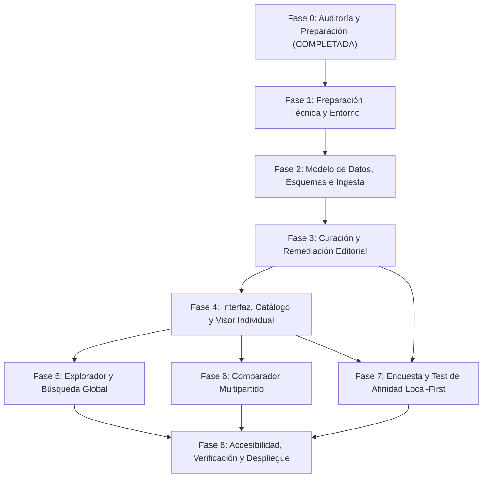

# IMPLEMENTATION_PLAN — Plan de Implementación por Fases

- **Versión:** 1.0.0
- **Fecha:** 2026-11-12
- **Estado:** Planificado (Listo para ejecución tras la Fase 0)
- **Regla crítica:** Este documento detalla la planificación técnica. **No se debe implementar ninguna fase todavía.**

---

## 1. Resumen de Fases y Dependencias

| Fase | Denominación | Prerrequisitos | Archivos Principales Afectados |
| :---: | :--- | :--- | :--- |
| **0** | **Auditoría y Preparación** | Ninguno | `docs/*`, `AGENTS.md`, `scripts/auditar_corpus.py` (COMPLETADA) |
| **1** | **Preparación Técnica y Entorno** | Fase 0 | `.gitignore`, `package.json`, `tsconfig.json`, `tailwind.config.ts` |
| **2** | **Modelo de Datos e Ingesta** | Fase 1 | `src/modules/corpus/`, `tools/data/`, `data/registry/`, `data/taxonomy/` |
| **3** | **Curación y Remediación Editorial** | Fase 2 | `data/reviews/*.json`, `data/survey/questions.json` |
| **4** | **Interfaz, Catálogo y Visor Individual** | Fase 2, Fase 3 | `src/app/`, `src/modules/ui/`, `src/app/programas/` |
| **5** | **Explorador y Búsqueda Global** | Fase 4 | `src/modules/search/`, `src/app/buscar/` |
| **6** | **Comparador Multipartido** | Fase 4 | `src/modules/comparator/`, `src/app/comparar/` |
| **7** | **Encuesta y Test de Afinidad** | Fase 3, Fase 4 | `src/modules/survey/`, `src/app/encuesta/` |
| **8** | **Accesibilidad, Verificación y Despliegue** | Fases 4 a 7 | `tests/`, `.github/workflows/`, configuración de build |

---

## 2. Detalle de Fases de Ejecución

### FASE 1: Preparación Técnica y Entorno
- **Objetivo:** Configurar el entorno de desarrollo base del monolito modular Next.js en TypeScript estricto, sin tocar los archivos de datos existentes.
- **Tareas Concretas:**
  1. **T1.1:** Crear `.gitignore` con exclusión de `node_modules/`, `.next/`, `.generated/`, artefactos de build y logs temporales, protegiendo explícitamente `pdfs_originales/` y `procesados/`.
  2. **T1.2:** Inicializar el proyecto con `package.json` instalando dependencias estrictamente necesarias: `next`, `react`, `react-dom`, `typescript`, `zod`, `minisearch`, `clsx`, `tailwind-merge` y Tailwind CSS.
  3. **T1.3:** Configurar `tsconfig.json` con modo estricto (`"strict": true`, `"noImplicitAny": true`, rutas aliadas `@/*` hacia `./src/*`).
  4. **T1.4:** Configurar `next.config.ts` permitiendo la entrega estática de los PDFs bajo `/pdfs/*` y optimizaciones de build estático.
  5. **T1.5:** Configurar ESLint y Prettier con reglas de accesibilidad (`eslint-plugin-jsx-a11y`).
- **Pruebas y Verificación:** `npm run build` compila un layout básico vacío sin errores de tipado.
- **Criterio de Aceptación:** Entorno listo, `git status` limpio y dependencias auditadas.

---

### FASE 2: Modelo de Datos, Esquemas e Ingesta Automatizada
- **Objetivo:** Implementar los esquemas de datos Zod y el script de compilación que transforma N0, N1, N2 y N3 en el dataset normalizado N4 (`.generated/corpus.v1.json`).
- **Tareas Concretas:**
  1. **T2.1:** Implementar `src/modules/corpus/schema.ts` conteniendo los esquemas Zod formales de todas las entidades de `DATA_MODEL.md` (`Party`, `Program`, `Proposal`, `Evidence`, `Review`, `Theme`).
  2. **T2.2:** Crear `data/registry/documents.json` y `data/taxonomy/themes.json` con los 19 bloques canónicos y los metadatos de los 9 documentos auditados.
  3. **T2.3:** Desarrollar `tools/data/locate-evidence.ts` trasladando el algoritmo probado en `scripts/auditar_corpus.py` para mapear textos oficiales a `prov[0].page_no` del JSON de Docling.
  4. **T2.4:** Desarrollar `tools/data/build-corpus.ts` que:
     - Valide los SHA-256 de los 9 PDFs contra `metadata.json`.
     - Ingeste las 1.652 medidas de los `*_detallado.json`.
     - Calcule evidencias automáticas y aplique reglas de cuarentena (`requiere_revision`).
     - Aplique overlays de `data/reviews/*.json`.
     - Valide todas las invariantes y emita `.generated/corpus.v1.json` y `.generated/reports/`.
  5. **T2.5:** Desarrollar `tools/data/export-schema.ts` para sincronizar los esquemas JSON de `data/schema/`.
- **Pruebas y Verificación:** Ejecución de `npm run data:build`. El proceso debe completar en < 15 segundos, verificar los 9 hashes SHA-256 e identificar las 1.652 medidas con cero fallos de validación Zod.
- **Criterio de Aceptación:** Archivo `.generated/corpus.v1.json` generado con todas las invariantes superadas.

---

### FASE 3: Curación y Remediación Editorial (Datos N3)
- **Objetivo:** Resolver mediante overlays en `data/reviews/` los hallazgos críticos detectados en la auditoría (Fase 0) antes de la exposición pública de datos.
- **Tareas Concretas:**
  1. **T3.1:** Crear `data/reviews/pp.json` clasificando las 8 medidas de campaña (83, 109, 132, 164, 167, 173, 200, 210) como `kind: "reservada"` y `status: "rechazada"`.
  2. **T3.2:** Crear `data/reviews/frente-obrero.json` separando las anotaciones entre corchetes (`[Medida N...]`) del `texto_oficial` en las 6 medidas afectadas (FO-001, FO-006, etc.).
  3. **T3.3 (Remediación E-2):** Crear `data/reviews/partido-humanista.json` cotejando las 33 medidas no literales con la capa de texto real del PDF (subsanando erratas factuales como el importe de la RBUI en PH-002) y habilitando su publicación.
  4. **T3.4 (Remediación E-3):** Crear `data/reviews/salf.json` cotejando las medidas con el PDF y consignando su numeración original identificada.
  5. **T3.5 (Revisión E-4):** Revisar la neutralidad de los títulos visibles de los 19 bloques temáticos en `data/taxonomy/themes.json` para garantizar un lenguaje institucional y no tendencioso.
  6. **T3.6:** Construir el banco inicial de 15 preguntas de la encuesta en `data/survey/questions.json` con codificación contrastada de los 9 partidos y justificación documental vinculada a propuestas de N4.
- **Pruebas y Verificación:** Re-ejecución de `npm run data:build`. Ninguna medida con texto adulterado o anotaciones espurias pasa al estado `verificada` o `extraida` publicable.
- **Criterio de Aceptación:** Cobertura de propuestas publicables certificada y banco de preguntas validado al 100%.

---

### FASE 4: Interfaz, Catálogo y Visor Individual de Programas
- **Objetivo:** Construir la base de diseño accesible y las vistas principales de exploración por partido.
- **Tareas Concretas:**
  1. **T4.1:** Implementar el layout raíz (`src/app/layout.tsx`) con `<SkipToContent />`, encabezado accesible, navegación persistente y pie de página con créditos y enlaces institucionales.
  2. **T4.2:** Configurar variables CSS (`tokens.css`) y componentes atómicos accesibles (`Button`, `Card`, `Badge`, `Modal`, `Callout`).
  3. **T4.3:** Implementar la página principal (`src/app/page.tsx`) con el hero informativo, el catálogo de tarjetas de los 9 programas, filtros rápidos y estadísticas globales.
  4. **T4.4:** Implementar el visor de programa individual (`src/app/programas/[partyId]/page.tsx`):
     - Cabecera con datos del programa, SHA-256 y descarga del PDF.
     - Índice lateral flotante por bloques canónicos.
     - Listado de propuestas agrupadas con cita textual en su lengua oficial.
     - Modal y botón de evidencia que enlaza al PDF oficial en `/pdfs/<archivo>.pdf#page=X`.
     - Panel de transparencia con desglose de propuestas publicadas y en revisión.
- **Pruebas y Verificación:** Navegación por teclado completa (Tab, Shift+Tab, Enter, Escape). Pruebas de renderizado responsivo (móvil 375px y escritorio 1440px).
- **Criterio de Aceptación:** Los 9 programas son navegables, los enlaces a las páginas de PDF funcionan de forma nativa en el navegador y los textos de análisis IA no se muestran en pantalla.

---

### FASE 5: Explorador y Búsqueda Global
- **Objetivo:** Desarrollar el buscador instantáneo facetado sobre el conjunto de propuestas publicadas.
- **Tareas Concretas:**
  1. **T5.1:** Crear `src/modules/search/` con inicializador de `MiniSearch` que cargue el índice pre-compilado en build (`search-index.v1.json`).
  2. **T5.2:** Implementar la interfaz de `/buscar` (`src/app/buscar/page.tsx`) con campo de búsqueda, filtros facetados (partidos, bloques temáticos, estado de revisión) y botón de limpieza.
  3. **T5.3:** Sincronizar el estado del buscador con la URL (`?q=...&partido=...&bloque=...`) mediante `useSearchParams`.
  4. **T5.4:** Renderizar resultados con resaltado de términos coincidentes, metadatos de sección y acceso directo a la evidencia de página en el PDF.
- **Pruebas y Verificación:** Búsqueda de términos clave en español y gallego (ej. "vivienda", "alugueiro", "IRPF", "SMI") devuelve resultados exactos en < 50 ms.
- **Criterio de Aceptación:** Búsqueda operativa, compartible por URL y con estados de *Sin resultados* informativos.

---

### FASE 6: Comparador Multipartido
- **Objetivo:** Implementar la herramienta de comparación temático-matricial entre 2 y 4 formaciones políticas.
- **Tareas Concretas:**
  1. **T6.1:** Crear `src/modules/comparator/` con la lógica de emparejamiento por los 19 bloques canónicos.
  2. **T6.2:** Diseñar la interfaz de selección de partidos en `/comparar` (selector interactivo con límite de 2 a 4 formaciones).
  3. **T6.3:** Desarrollar la tabla matricial de escritorio: columnas por partido seleccionado y filas por bloque temático común.
  4. **T6.4:** Implementar el tratamiento explícito de ausencias: etiqueta clara *"Sin propuestas registradas en este bloque"* cuando una formación no tenga medidas indexadas.
  5. **T6.5:** Diseñar la adaptación móvil: colapso en acordeón o pestañas por bloque temático.
- **Pruebas y Verificación:** Comparar partidos con bloques vacíos (ej. Frente Obrero en bloque 11 vs PNV) y verificar que no se produzcan descuadres visuales ni afirmaciones erróneas de equivalencia.
- **Criterio de Aceptación:** Comparador fluido, accesible y metodológicamente estricto.

---

### FASE 7: Encuesta y Test de Afinidad Local-First
- **Objetivo:** Desarrollar el cuestionario de orientación temática de 15 preguntas con cálculo privado en navegador.
- **Tareas Concretas:**
  1. **T7.1:** Implementar la interfaz de cuestionario en `/encuesta` (`src/app/encuesta/page.tsx`) presentando una afirmación a la vez, con escala Likert de 5 botones y opción *"Prefiero no responder"*.
  2. **T7.2:** Desarrollar el motor de cálculo en cliente (`src/modules/survey/calculator.ts`) aplicando la fórmula de afinidad de [D-012](DECISIONS.md#d-012-algoritmo-de-encuesta-local-first-con-distinción-de-posición-vs-silencio).
  3. **T7.3:** Implementar la pantalla de resultados con:
     - Gráficos de barras o porcentaje de afinidad por partido.
     - Indicador obligatorio de cobertura de datos (preguntas computadas vs excluidas por silencio del partido).
     - Desglose por bloque temático.
     - Desplegable de justificación documental que muestra las propuestas oficiales que motivaron la coincidencia o discrepancia.
     - Cláusula de privacidad y descargo de responsabilidad electoral.
  4. **T7.4:** Almacenar respuestas en estado local o `sessionStorage` para permitir volver atrás sin recargar la página; cero llamadas a endpoints de registro.
- **Pruebas y Verificación:** Casos de prueba unitarios con vectores de respuesta conocidos (usuario que responde todo afirmativo, usuario que marca "Prefiero no responder" en 5 preguntas).
- **Criterio de Aceptación:** Resultados transparentes, reproducibles, auditables y con privacidad garantizada.

---

### FASE 8: Verificación, Accesibilidad y Preparación para Despliegue
- **Objetivo:** Garantizar la calidad técnica, el cumplimiento normativo WCAG 2.2 AA y la estabilidad del build final de producción.
- **Tareas Concretas:**
  1. **T8.1:** Completar la página de `/metodologia` con la documentación del pipeline, informe de auditoría embebido y tablas de trazabilidad.
  2. **T8.2:** Auditoría de accesibilidad completa con `axe-core` y Lighthouse: resolver cualquier incidencia de contraste, navegación por teclado o etiquetado ARIA.
  3. **T8.3:** Generación dinámica de `sitemap.xml` y `robots.txt` para indexación neutral en buscadores.
  4. **T8.4:** Configuración del flujo de integración continua en GitHub Actions (`.github/workflows/ci.yml`) ejecutando `lint`, `typecheck`, `data:build`, `test` y `build`.
  5. **T8.5:** Pruebas finales de compilación estática de producción (`npm run build`).
- **Pruebas y Verificación:** Auditoría Lighthouse ≥ 90 en todas las categorías en móvil y escritorio.
- **Criterio de Aceptación:** Aplicación 100% lista para producción, verificable por cualquier revisor independiente.
